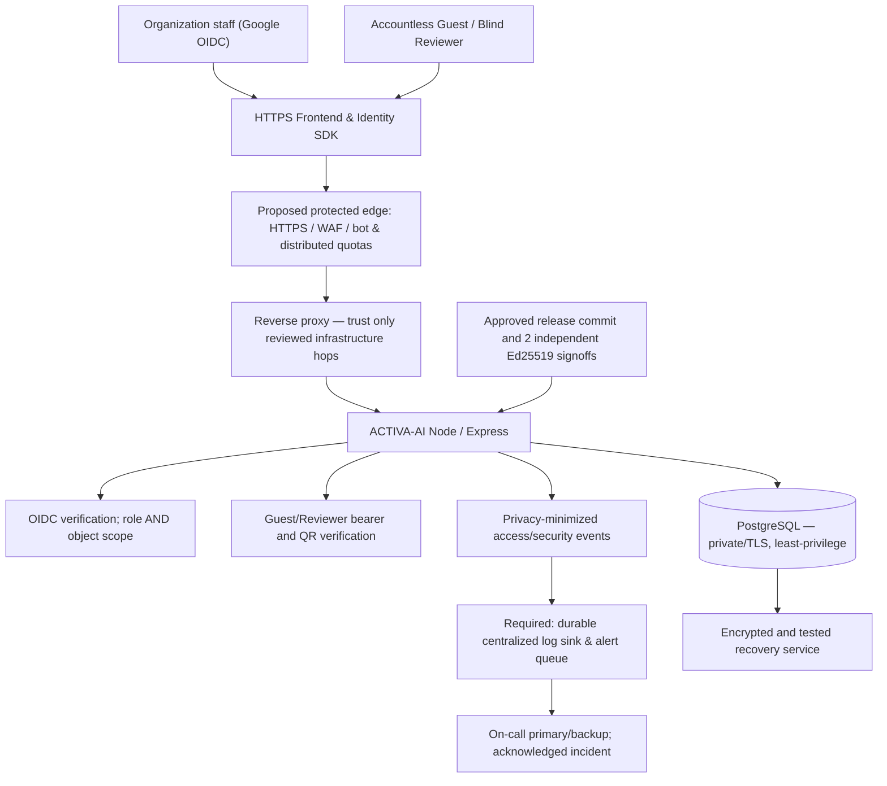

# ACTIVA-AI — Production Security Architecture & P0 Gap Closure

**Technical status: security architecture is a proposed design and branch-level code review candidate.**
**Production Security Acceptance: HOLD / NO-GO.**
**Human-participant research ethics/site approval: separate HOLD.**
**No Staging or Production deployment is performed by this review.**

## 1. Intended trust boundaries and system diagram



**Trust boundary 1:** Browser, QR token, Guest Pass and Authorization header are
**untrusted**, even when the browser UI hides a control. Every API endpoint
must independently verify authorization and intended activity/object scope.
User-supplied `X-Forwarded-For` must never be trusted directly.

**Trust boundary 2:** Edge/reverse proxy is a **proposed** deployment control,
not present/verified merely because an Express server and CI exist.
Document exact hop/IP configuration and reject requests missing a trusted
forwarding chain if adopting IP-derived security controls.

**Trust boundary 3:** Application DB access must be private and TLS-protected.
The API's operational permissions must not include database administration,
schema migration or unrestricted external access. Run migrations separately,
with restricted migration credentials; verify restore and data retention.

**Trust boundary 4:** Provider logs, security alerts and backups are sensitive
institutional operational data, requiring explicit retention, encryption,
role restrictions and secondary failover; GitHub Issue creation is not
evidence of incident acknowledgment.

## 2. Verified code baseline and S3.1 remediation

| Domain | Observed current code/design | Readiness |
| --- | --- | --- |
| Identity | Google OIDC server validates signature/audience/issuer/lifetime, verified email and institution/pilot allowlist; provisioned, ACTIVE local user required | Implemented, real OIDC Staging acceptance missing |
| Object authorization | Server roles plus scoped activity/QR/evidence access; S2.1–S2.14 CI | Implemented in proposed Draft changes; complete endpoint/privacy review pending |
| Guest attendance | Random bearer pass, hashed storage, revocation, expiration, consent/QR activity binding; pass possession is NOT identity | Implemented, device/operational checks pending |
| API throttling | Per-process fixed-window IP/actor/Guest/Reviewer with bounded state; no trusted forwarded IP by default | **P0 unresolved:** shared multi-instance edge/distributed protection and campus NAT load |
| Frontend | CSP, no executable inline JS, SRI pinned to two QR CDN byte hashes, escaping regression and localhost Chromium | Implemented, actual hosted Origin and mobile/camera OIDC pending |
| Access logs | In-process category aggregation and privacy-safe path templates | **P0 unresolved:** durable SIEM/sink with retention and correlation |
| GitHub alerts | Optional off-by-default; per-process serialized same-category Issue writes and stricter receipts | **P0 unresolved:** persistent retry/queue, multi-instance dedupe and confirmed responder acknowledgment |
| Database transport | **S3.1** now rejects Production DB URL without one unambiguous TLS sslmode; rejects insecure `sslaccept` overrides | Implemented in proposed branch, end-to-end TLS/cert verification not yet observed |
| Release governance | **S3.1** now blocks Production GO at startup and ADMIN release action unless two distinct valid Ed25519 signatures bind to exact deployment SHA and short expiry | Implemented in proposed branch; independent signer custody and source evidence not yet operational |
| Disaster recovery | Backup/recovery checks in application, original CI synthetic | **P0 unresolved:** verified restore on isolated environment, recovery time and retention |

## 3. S3.1 actual fail-closed changes

### Production database TLS

When `ACTIVA_DEPLOYMENT_TIER=PRODUCTION`, `DATABASE_URL` must contain
**exactly one** `sslmode=require`, `sslmode=verify-ca`, or
`sslmode=verify-full`. The connection may not contain
`sslaccept=accept_invalid_certs`. This blocks an accidental URL with
`sslmode=disable`, `prefer`, multiple contradictory `sslmode` values or
no TLS policy. Prefer `verify-full` with reviewed CA/hostname support.

This is a **configuration enforcement**, not direct proof of which CA was
used or actual TCP transport. Operations must verify a successful TLS
connection and server certificate validation on approved Staging.

### Independent signed Production acceptance

Two separate security and operations signing authorities each sign the
**same** canonical message:

```text
ACTIVA-AI-PRODUCTION-SECURITY-GO-V1
<exact 40-hex Render deployment commit>
<expiry as exact UTC ISO-8601 timestamp>
<nonce as 32-128 lowercase hex characters>
```

The message includes a final newline. Signing uses **Ed25519**; the app
verifies signatures against **two different public SPKI DER keys**, encoded
in canonical base64. Raw private keys must remain **outside** the app,
repository, environment variables, GitHub Actions and database.

Required environment values at an authorized Production release review:

| Variable | Meaning |
| --- | --- |
| `RENDER_GIT_COMMIT` | Deployment-provided exact 40-character commit, not an arbitrary app-controlled alias |
| `ACTIVA_RELEASE_APPROVED_COMMIT` | Exact same commit covered by both signatures |
| `ACTIVA_RELEASE_APPROVED_UNTIL_UTC` | Strict UTC expiration; max 24-hour future window |
| `ACTIVA_RELEASE_APPROVAL_NONCE` | Secure random nonce; prevents ambiguous repeated message bodies |
| `ACTIVA_RELEASE_SECURITY_PUBLIC_KEY_B64` | Security owner's Ed25519 public key DER SPKI |
| `ACTIVA_RELEASE_OPERATIONS_PUBLIC_KEY_B64` | Different Operations owner's Ed25519 public key DER SPKI |
| `ACTIVA_RELEASE_SECURITY_SIGNATURE_B64` | First authority's Ed25519 signature of canonical message |
| `ACTIVA_RELEASE_OPERATIONS_SIGNATURE_B64` | Second authority's Ed25519 signature of canonical message |
| `ACTIVA_PRODUCTION_GO_ENABLED` | Separate explicit operator switch, not proof by itself |

The API starts only with all required signatures valid when the production
tier has GO enabled, and **both**
`GET /api/operations/release-gate` and
`POST /api/operations/release-decision` retain an independent
cryptographic HOLD check. Staging can keep GO disabled and continue CI.
A forced or forged Boolean GO environment switch is insufficient.

**Limit:** cryptographic verification proves that possession of each
designated private key was used to sign the exact data. It does **not**
prove that the signer is institutionally authorized, physically distinct,
has read the risk register, or has inspected Staging. Operations must
register key fingerprints/ownership, store review evidence in a protected
institutional system, enforce signer separation, rotate/revoke keys, and
verify no unresolved critical/high defects. No private-key generation,
distribution or institutional signature issuance is automated by this PR.

## 4. Operational P0 closure plan

| Priority | Remaining work | Accountable owner | Required hard evidence |
| --- | --- | --- | --- |
| P0 | Independent AppSec and privacy review of cumulative Draft security PRs | Security lead + DPO | File-by-file authorized review, risks, exception records |
| P0 | Separate Staging, Database, network and keys; explicit trust proxy topology | Infrastructure + DB administrator | Staging URL, deployed commit, DB instance/credential isolation, real TLS proof |
| P0 | Network WAF, edge/distributed quotas and shared Wi-Fi/IP analysis | Infrastructure + AppSec | Cloud/edge policy, spoofed proxy test, 200+ simulated concurrent attendees and representative latency/error metrics |
| P0 | Centralized security/event logging, durable alerts, responder runbooks, retention | SOC/operations | Endpoint destination, 2 designated on-call owners, actual alert delivery/acknowledgment, queue failure and recovery tests |
| P0 | Backup encryption/restore, secrets/key rotation and recovery rehearsal | DB + operations | Isolated restore job, tested RPO/RTO, separation of migration and runtime privileges |
| P0 | Human review and release decision with independent cryptographic signoffs | Security authority + Operations authority | Evidence tickets for all S2.10 M01–M13, authorized keys and signatures for exact SHA |
| P1 | Complete DOM XSS review, CSP stricter API connect-src and external CDN provenance | Frontend + AppSec | Browser penetration report/mitigations verified on actual hosted Staging |
| Separate | Research ethics/site approval | PI + ethics committee | Authorized letter/protocol and consent before human research data |

**Do not replace these hard-evidence rows with Boolean env flags.**
A green CI proves only its test scope; it never verifies the actual campus
proxy, production network controls, human alert handling or ethics review.

## 5. P0 deployment decision

- Until real Staging acceptance and independent evidence are complete:
  **NO-GO/HOLD** even if the code passes full CI.
- Until infrastructure audit proves either a single protected instance
  under approved constraints OR a distributed edge limiter:
  do **not** claim 200-user multi-instance security readiness.
- Until centralized logs and alert delivery are durable and humans
  acknowledge actual incidents: **do not** mark SOC readiness PASS.
- Until institutional signer custody is established and two independent
  signatures validate against the exact installed commit:
  **Production GO cannot be enabled** with the S3.1 configuration guard.
- Until Phase 4 institution/ethics approval is obtained:
  **no empirical participation data collection**, independently of software GO.

## 6. Automated software evidence

`tests/production-security-architecture.mjs` uses **two generated ephemeral
Ed25519 keypairs in memory**, never Production secrets, to verify a nominal
authorized signing case and negative cases: wrong SHA, swapped/duplicate
keys, expired/future approvals, invalid signature and missing public key.
It checks TLS reject cases and confirms both GO endpoints use the approval
gate. The existing `tests/deployment-config.mjs` now rejects a self-attested
production GO with no independent security signatures.

**Release approval remains HOLD pending external evidence and institution
authorization. This branch must remain Draft until independently reviewed.**
