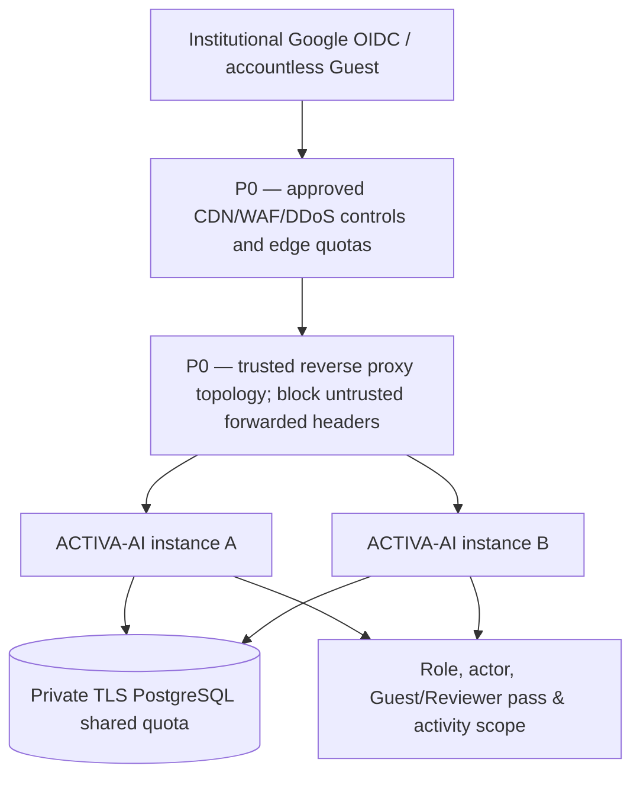

# ACTIVA-AI — S3.2 Distributed Rate Limiting & Edge Security

**Technical candidate only. No Production/Staging requests, deployment or human research data.** Production Security Acceptance: **HOLD**.

## 1. What was implemented in the actual source code

The former S2.2 fixed-window limiter used per-process in-memory Maps.
That is still an optional **STAGING/GO-disabled local fallback**, but not
sufficient for multiple application replicas or a production GO decision.

S3.2 introduces a **shared PostgreSQL-backed atomic quota** and a
fail-closed middleware compatible with the seven existing categories:

| Category | Default per 60-second window | Purpose |
| --- | ---: | --- |
| `all_ip` | 3,000 | Coarse request flood backstop; deliberately high for campus shared NAT |
| `guest_ip` | 900 | Campus guest request backstop |
| `guest_pass` | 36 | Individual possession-token quota |
| `reviewer_ip` | 300 | External reviewer network backstop |
| `reviewer_pass` | 36 | Individual blind-review invitation quota |
| `actor` | 600 | Per-authenticated-account requests |
| `actor_write` | 180 | Per-authenticated-account writes |

**These are conservative defaults from the existing code, not a scientifically
measured throughput benchmark**. Security and Operations must recalibrate
after genuine approved Staging load and false-positive tests.

The PostgreSQL migration creates `SecurityRateLimitBucket` with a
64-hex-character HMAC SHA-256 key, database-time fixed window, shared
atomic increment and expiry index; **no plaintext IP, email, account ID,
participant ID or bearer token is stored**. Each replica sharing the same
PostgreSQL database and scoped `ACTIVA_RATE_LIMIT_HMAC_SECRET` counts
against the same token/actor/network quota.

A single PostgreSQL `INSERT ... ON CONFLICT DO UPDATE RETURNING`
computes the window from the database clock (not process clocks), so
simultaneous requests on different replicas do not bypass the quota.
All requests receive either an admitted response, a 429 with Retry-After
or fail-closed 503 when the shared limiter database is unavailable.
Expired buckets are opportunistically removed; Production must still
set explicit database retention/monitoring and may use scheduled vacuum.

## 2. Configuration and deployment rules

| Setting | Safe use |
| --- | --- |
| `ACTIVA_RATE_LIMIT_STORE` | `POSTGRES` for Production GO; `MEMORY` for disposable local/demo/Staging testing only |
| `ACTIVA_RATE_LIMIT_HMAC_SECRET` | Independently generated high-entropy secret (at least 32 chars), shared ONLY by authorized replicas; never use research salt or QR signing secret |
| `DATABASE_URL` | Dedicated private PostgreSQL with least-privileged table access, TLS and bounded connection pool |
| `ACTIVA_RATE_LIMIT_ENABLED` | Cannot disable Production application rate protection |

When Production tier has `ACTIVA_PRODUCTION_GO_ENABLED=true`, the
server rejects `MEMORY` or an absent/invalid HMAC secret at startup,
in addition to the existing signed independent Security/Operations
approval from S3.1. This is a *configuration gate*, not proof that real
infrastructure or WAF rules were independently inspected.

There is no automatic deployment, GitHub secret creation, database credential
rotation or cloud WAF configuration in this PR.

## 3. Trust-boundary and edge requirements — still P0

The Node app explicitly keeps Express `trust proxy=false` by default:
untrusted `X-Forwarded-For` headers may not select new quota keys.
When behind a load balancer this means all visitors can appear as the
balancer's IP to the coarse IP quotas. **Do not enable `trust proxy=true`
blindly**: document the precise proxy chain, addresses and sanitization,
or derive network identity from a rigorously verified edge identity
header; additionally enforce edge quotas before reaching the application.

A campus's 200–250 participants may share one public NAT IP. Fine-grained
GuestPass/BlindReview/actor quotas preserve per-person fairness, but the
shared `all_ip`, `guest_ip` and reviewer IP buckets can become PostgreSQL
row-lock hot spots. A production deployment needs edge WAF rate limiting,
load/proxy analysis, abuse and latency testing, and likely an independent
managed distributed rate-limit store (e.g. Redis) or bucket sharding
after measured evidence. The PostgreSQL backend **is not a benchmarked
200-user scalable edge service**.

Consider applying a more restrictive budget to unauthenticated malformed
tokens and unauthenticated expensive APIs at the edge. Do not rely only
on an authenticated quota because missing bearer credentials have no actor
key and are correctly denied by the authorization middleware.

## 4. Actual verification included in S3.2

- Real **disposable localhost PostgreSQL in CI** with the new migration,
  no authorized research participants, actual Production endpoints or staff.
- Two independent in-process limiter/store instances sharing the same
  database: 64 concurrent writes from one actor must allow exactly 25 and
  reject the remaining 39.
- Independent second actor remains unaffected.
- **210 synthetic Guest passes behind one NAT**, split between two limiter
  instances: no unjustified shared-network 429 at default limits.
  This is a deterministic functional check, **not peak throughput or
  cross-host distributed load measurement**.
- Faked forwarding headers do not change token/actor identity.
- Invalid store responses or PostgreSQL outages yield HTTP 503, never
  pass uncounted requests.
- HMAC-derived bucket IDs never expose raw IP/account IDs/tokens.
- S3.1 dual-Ed25519 release and DB TLS tests remain in CI. Other S2.1–S2.14
  regression, browser, guest, reviewer, Docker and synthetic ML checks remain
  unchanged.

## 5. Remaining Production GO blockers

1. Independent AppSec review of the SQL concurrency, config, account scoping,
   brute-force handling, database permissions and privacy compliance.
2. Approved isolated Staging origin and deployed source revision with
   dedicated test PostgreSQL; run actual multi-replica proof under the
   organization's reverse proxy/CDN.
3. Run **>=200 simultaneous synthetic users** from realistic network types;
   measure p50/p95/p99, PostgreSQL row locking, 429 false positives,
   unavailable-store behavior, edge effectiveness and 2+ replicas.
4. Verify cloud WAF/DDoS/edge policy, hop-by-hop forwarded header protection,
   secret custody/rotation, DB TLS, provisioned roles and backups.
5. Close separate centralized security logging / durable alert delivery,
   independently signed release readiness, OIDC/QR physical-device acceptance,
   Incident Response, privacy and research ethics gates.

**S3.2 is a safer software design candidate, not operational Production security
approval. Do not merge/deploy from a passing CI result alone.**
