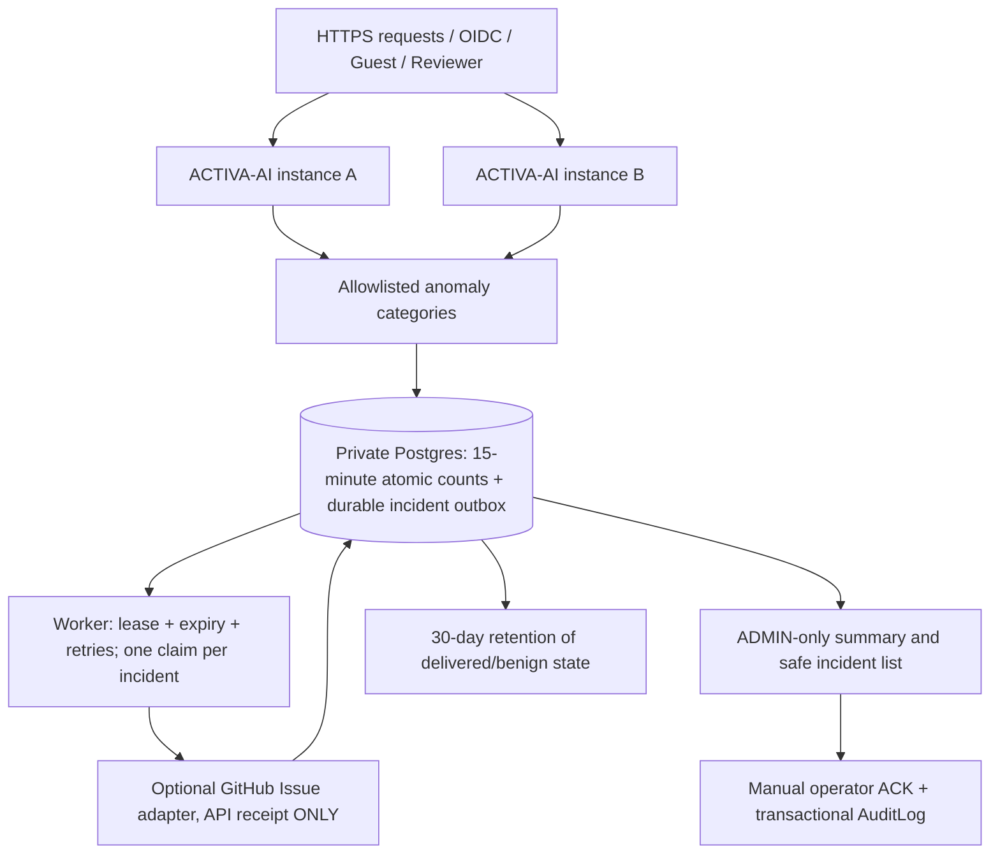

# ACTIVA-AI S3.3 — Durable Centralized Security Incidents & Human Response

**Status: DRAFT / software-level candidate; not a Production Security GO.**
S3.3 is stacked on S3.2 PR #151 and unmerged prior Security PRs.

## 1. Architecture and trust boundaries

Application security events included in durable aggregate counters:
`AUTH_DENIED`, `ACCESS_DENIED`, `RATE_LIMITED`,
`SERVER_ERROR`. The app retains previous process-local counters for
fast operational summaries, but a shared **database-counter** drives the
new alert threshold across replicas, not the process-local threshold.

Every security category hit updates exactly one shared 15-minute window
row atomically. Rows store **category, count, threshold, status, timestamps,
attempt count and a random lease**; no raw IP address, account identifier,
request body, URL query, Guest Pass, QR secret or bearer token.

The new `SecurityEventSample` table retains ONLY sampled allowlisted
route templates, method, scope, status category and audit action name;
sampled payloads never copy raw request metadata or user-supplied object IDs.
Permanent privileged action attribution remains in existing `AuditLog`.

## 2. Durable delivery and crash recovery

- At the window threshold, an atomic SQL upsert transitions
  `COUNTING → PENDING`; concurrent replicas cannot create separate
  outbox records for the same category and 15-minute window.
- An outbox worker claims a pending incident via database
  `FOR UPDATE SKIP LOCKED` and a 45-second lease, then calls the existing
  GitHub adapter **only if it is explicitly enabled**.
- Successful GitHub Issue/comment receipt transitions to `DELIVERED`,
  **not** to human-acknowledged. A failing/disabled adapter is released
  back to `PENDING`, with bounded exponential retry backoff.
- If a process is killed after claiming, another worker can reclaim the
  expired lease. A process restart does not erase pending database alerts.
- No credentials, body or error objects from the remote GitHub response
  appear in incident records. GitHub API errors are logged using generic
  rate-limited codes.

**Exactly-once across GitHub is NOT guaranteed**: if the GitHub request
succeeded but the process crashed before recording `DELIVERED`, a later
retry may add a duplicate comment. Multi-instance Issue creation also
needs review of category-level provider idempotency. The database
guarantees a single *claimed attempt* at a time within the 45-second lease,
not end-to-end exactly-once external notification.

## 3. Human incident acknowledgment

With `ACTIVA_SECURITY_INCIDENT_STORE=POSTGRES`:

| API | Authorization | Behavior |
| --- | --- | --- |
| `GET /api/operations/security-summary` | ADMIN | Returns existing memory monitor plus persistent status counts |
| `GET /api/operations/security-incidents` | ADMIN | Latest 20 sanitized category/window rows; excludes actor/token/IP, acknowledgment identity and raw logs |
| `POST /api/operations/security-incidents/:id/ack` | ADMIN | Requires `DELIVERED` and no prior acknowledgment; performs operator identity record + `SECURITY_INCIDENT_ACKNOWLEDGED` AuditLog inside a single database transaction |

A `DELIVERED` entry means **GitHub accepted an Issue/comment**, not that
any person received a notification. Only `acknowledgedAt` plus the
corresponding authorized AuditLog indicates a manually recorded action.
This still requires operational policy: designated primary and backup
on-call responders, incident SLA, escalation runbook and independent proof
that the recipient actually reviewed the event.

## 4. Deployment controls

`ACTIVA_SECURITY_INCIDENT_STORE` defaults to `DISABLED` to avoid changing
existing demos/disposable CI unexpectedly. It can be explicitly set to
`POSTGRES` once migration, DB roles and operator runbook are ready.

A Production GO environment now **requires**:
- `ACTIVA_SECURITY_INCIDENT_STORE=POSTGRES`;
- `ACTIVA_SECURITY_ALERT_MODE=GITHUB_ISSUE` and validated private repo,
  GitHub App/fine-grained token and designated assignee under the existing
  adapter's config validation;
- S3.2 `ACTIVA_RATE_LIMIT_STORE=POSTGRES` with separate HMAC key;
- S3.1 independent Security/Operations signed release + Production DB TLS;
- Any other existing deployment checks.

These are fail-closed **configuration requirements**, not authorization
to enable GO and not evidence of actual live delivery or human signoff.
Security operations must independently validate scoped, least-privilege
GitHub token custody, API failure behavior and trusted egress controls.

Only `DELIVERED` or `COUNTING` incidents may be removed after 30 days.
`PENDING` and `LEASED` alerts remain and require response/escalation
even if older than retention cutoff. Sampled events are purged at 30 days.
Operators must verify lawful retention, access restriction, encryption,
backup/restore, DB capacity and right-to-erasure policy.

## 5. Verification

`tests/security-incident-persistence.mjs` exercises the **actual disposable
PostgreSQL service in GitHub Actions** with:
- 51 concurrent rejected logins split across two simulated server stores
  → **one** persisted 15-minute incident row, incremented count 51.
- Concurrent workers from two stores can claim/deliver the incident once.
- GitHub sender is mocked; **NO actual GitHub Issue is created**.
- Failed remote delivery remains PENDING and is retried from a new store;
  expired lease is recovered after a simulated crash.
- ADMIN/manual acknowledgment updates durable row and exactly one
  permanent `AuditLog` entry atomically; repeat/invalid ACK rejected.
- Sampled events exclude request IDs, IP, employee IDs and tokens.
- 30-day cleanup removes only permitted data, never pending incidents.
- Production configuration rejects an absent durable store/alert mode.

Legacy S2.3–S2.14 and S3.1–S3.2 CI tests remain in place.

## 6. Remaining Production Security HOLD gates

**P0: Not yet established in real Staging:** approved distinct service and
database, independent code review, HA database and connection pool,
live multi-replica worker under crash/network partitions, valid real
GitHub Issue delivery, primary/backup human receipt and fallback,
central SIEM log export/retention, approved WAF/edge network policy,
200+ simultaneous synthetic users from campus NAT, real Google OIDC,
physical Android/iOS QR camera, and disaster-recovery drill.

**Audit note:** durable anomalies stored in Postgres are a *centralized
application-level sink*, **not** an independent provider/SIEM pipeline.
A privileged DB compromise could affect both the incident queue and the
application. Operations must design an external immutable/append-only
event export and data-access separation before final approval.

**Research ethics:** Phase 4 approval and site permission remain
independent and HOLD. No empirical participation or consent collection is
authorized by passing this software CI.

**S3.3 GO/NO-GO: NO-GO / HOLD until independent Staging & operational
acceptance and institutional approvals.**
