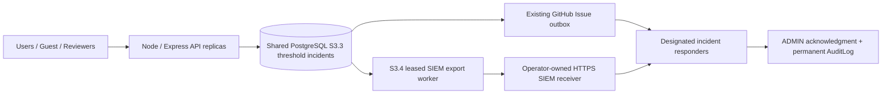

# ACTIVA-AI S3.4 — External SIEM Incident Export Architecture

**Status:** DRAFT. This software candidate has not delivered any real
institutional Security Information and Event Management (SIEM) message,
been deployed to Staging, or received Production acceptance.

## Purpose and independent trust boundary

S3.3 stores anonymized/de-identified security **incident threshold events**
in PostgreSQL, alongside a GitHub Issue alert worker and a distinct human
incident acknowledgment record. Both the alert and source DB can be
affected by a DB compromise or outage. S3.4 adds an **optional independent
external receiver**, using HTTPS, signed minimal payloads and durable
outbound retry state, without treating GitHub receipt, SIEM receipt and
human acknowledgment as interchangeable.



**This exports threshold incident summaries only, NOT every HTTP access
log, personnel record, or the full AuditLog.** The third-party SIEM,
retention and network egress implementation must be set up separately by
Operations. No actual SIEM service, credential, account or domain was
provisioned by this PR.

## Data schema and delivery

The outbox uses **independent fields** on each `SecurityIncidentWindow`:
`siemStatus`, `siemNextAttemptAt`, `siemLeaseId`, `siemLeaseUntil`,
`siemAttempts`, `siemDeliveredAt`, `siemReceiptId`.

- Shared database-clock threshold crossing atomically enters
  `siemStatus=PENDING` only if export is explicitly enabled.
- One replica claims one due incident with `FOR UPDATE SKIP LOCKED`
  and a 45-second lease. A later replica can recover abandoned leases.
- Payload contains only protocol/schema version, deterministic pseudonymous
  event ID, category, threshold and stable minimum count at detection,
  severity, first-seen UTC, and application source label. Mutable running
  counts are deliberately excluded so the exact signed JSON is identical
  on retry and a remote idempotent receiver can safely deduplicate it.
- Each request is an HTTPS POST to the fixed path
  `/v1/activa-security-events` of the exact, operator-configured origin.
  No redirects are accepted. A header contains an HMAC-SHA256 over
  the exact JSON bytes, using a dedicated outbound signing secret.
- The receiver must validate signature, trust the exact integration key,
  deduplicate by event ID, durably ingest the event, and return a **200/202**
  JSON body with `accepted:true`, the exact `eventId`, and an opaque
  `receiptId`. Only then may the sender mark `siemStatus=DELIVERED`.
- Any timeout, error, malformed or mismatched receipt leaves the event
  pending for bounded exponential retry. A GitHub Issue receipt does not
  advance SIEM state; SIEM receipt does not create a human ACK.
- Cleanup of old incident windows requires both the existing GitHub
  incident state and the SIEM state to be `COUNTING` or `DELIVERED`.
  Pending exports are not silently deleted.

The receiver must implement replay/idempotency protection and
cryptographic key rotation with overlap. Retries are **at-least-once**,
not exactly-once: a crash after remote ingestion and before the database
receipt can repeat the same event ID.

## Operator configuration

| Variable | Required meaning |
| --- | --- |
| `ACTIVA_SECURITY_INCIDENT_STORE=POSTGRES` | S3.3 durable security event source |
| `ACTIVA_SIEM_EXPORT_MODE=HTTPS_WEBHOOK` | Explicit opt-in for actual outbound delivery |
| `ACTIVA_SIEM_EXPORT_ORIGIN` | Exact reviewed publicly resolvable HTTPS origin, no path/query/userinfo/IP/local host |
| `ACTIVA_SIEM_EXPORT_HMAC_SECRET` | Separate 32+ character high-entropy signing secret, held in secret manager |

Example **illustrative only**, NOT a real deployment:

```text
ACTIVA_SECURITY_INCIDENT_STORE=POSTGRES
ACTIVA_SIEM_EXPORT_MODE=HTTPS_WEBHOOK
ACTIVA_SIEM_EXPORT_ORIGIN=https://siem.your-institution.tld
ACTIVA_SIEM_EXPORT_HMAC_SECRET=<from-approved-secret-manager>
```

Do **not** copy example values into a working system. The origin must be
independently verified as institution-controlled; a textual hostname
validator cannot prove DNS resolution, prevent every SSRF/DNS rebinding
case, validate a vendor contract or enforce private-network egress.
Deploy behind an approved egress firewall with destination restrictions,
DNS/TLS certificate verification and real source-to-sink tests.

**Production GO fail closed:** `deploymentConfigurationErrors` requires
the enabled SIEM mode, the durable source and a valid non-placeholder,
independent signing secret whenever both tier=PRODUCTION and
`ACTIVA_PRODUCTION_GO_ENABLED=true`. S3.1 dual Security/Operations release
signatures, DB TLS, S3.2 shared rate limiter and S3.3 GitHub alerts
remain independent requirements. Config gates do not constitute
authorized actual deployment.

## Human incident response roles

| Role | Responsibility and evidence |
| --- | --- |
| Infrastructure operator | Approve SIEM receiver ownership, HTTPS origin, egress firewall, HMAC key custody and rotation |
| Primary on-call security responder | Receive a real controlled Staging alert; investigate independently; record case ID and human acknowledgement |
| Backup on-call responder | Demonstrate escalation if primary is unavailable; record acknowledgment and response time |
| Institutional data protection reviewer | Confirm no prohibited personal data, access restrictions, retention/export location and log deletion requirements |
| Security and Operations release approvers | Independently review SIEM receipt, response drill, alert loss/retry, failover, Recovery and sign an exact release candidate |

The application can verify transport and receipt protocol; it cannot
prove a human actually read or escalated an event or that the external SIEM
is operational without real tests and organizational evidence.

## Verification and known limits

`tests/security-siem-export.mjs` uses **disposable localhost PostgreSQL**
and a completely **mocked HTTPS receiver** (no real outside call), with:
- cross-replica aggregation and SIEM queue state;
- 2 simultaneous workers competing for one pending incident;
- correct signed JSON and strict matching ACK eventId;
- malformed 2xx receipt, failed response and durable retry;
- recovery after an expired 45-second lease;
- independence of SIEM status from GitHub delivery/human ACK;
- refusal to delete pending exports at retention cutoff;
- rejection of unsafe local/HTTP/path-bearing origins and reused keys.

The design retains residual P0 issues:
1. **Real dedicated Staging** with reviewed external SIEM domain and egress policy, plus actual source-to-receiver receipt evidence.
2. **Immutable/tamper-evident external retention** and backup, least-privilege SIEM access, secure audit and privacy/data-locality policy.
3. **Ingestion capacity and dropped-events audit:** threshold summaries are not full event streaming. Under DB outage, counts cannot be recorded, so the provider's independent access logs/WAF telemetry and alerts remain essential.
4. **Availability and alert correctness:** at-least-once exporter depends on PostgreSQL and external SIEM, may retry duplicates; test receiver idempotency, DNS/TLS errors, queue saturation and failover on true multi-replica Staging.
5. **People and operational control:** real primary + backup acknowledgment, escalation and tabletop exercise not done.
6. **PR integration, authorized Staging, Google OAuth, mobile QR, shared-network load, independent AppSec review and Phase 4 research ethics:** all still HOLD.

**Production Security: NO-GO / HOLD.** Passing local and CI tests is not
a substitute for Staging, institutional signoff or research authorization.
